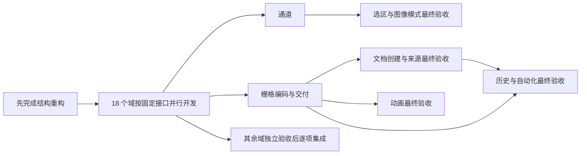

# PhotoCraft 上游 UI 缺口拆分计划

> **历史快照。** 计划对象是旧独立子项目的 React 编辑器，代码已在 client `64765113` 删除；
> 这些 change 都不会按原计划实施，保留仅为追溯当时的拆分依据。

根据 [2026-10-22 接入审计](../../../docs/audits/photocraft-upstream-coverage-2026-10-22.md)，按代码并行原则拆为 **1 个前置结构 change + 18 个功能 change，共 19 个**，覆盖全部 78 组缺口。这里记录计划归属，不是已实现清单。固定上游 `4e7a17cd5d5723313f459753663d0d155f047e19`，当前实现基线已提交为 `bdc3c0847fa7d2ed5db82128dafcf3f47ad1bfa1`。

原 change `2026-10-22-complete-photocraft-webui-editing` 的代码已经提交，但真实设备/外部应用验收仍按旧记录保留；本次不归档它，不用新规划自动补勾。复用其 capability 的后续 change 在归档前应先建立同名基线；不能覆盖原 Requirement 或创建近义副本。

## 并行启动门槛

[结构边界重构](../openspec/changes/archive/2026-10-22-refactor-photocraft-feature-boundaries/proposal.md) 已在 `b61da631b52cb44c453789be1bd9ef52a893291c` 实施并提交：集中 App/Canvas/控制器、Rust/WASM 和核验文件已抽出 `features/<domain>/`，18 个域的静态装配和接口已经建立。18 个功能 worktree 同步包含此前置提交的基线后可并行实施。详细 [设计和单一写入规则](../openspec/changes/archive/2026-10-22-refactor-photocraft-feature-boundaries/design.md) 与 [验证记录](../openspec/changes/archive/2026-10-22-refactor-photocraft-feature-boundaries/verification.md)。

各功能只写自己域的 UI/协议/Rust/核验目录和测试；共享 facade、版本/预算/fixture、宿主与公共 UI 由一个集成负责人顺序处理。文档来源/关闭与 codec 导出分开，调整与模式分开，视图/分析与命令定制分开，以消除同模块双 owner。

每个 change 使用独立 Git worktree、构建缓存和可用 dev 端口；同一 change 的 OpenCode/Codex 空闲会话共用它自己的 worktree，不等于授权两者同时修改同一文件。

## 交付顺序与入口

| 功能 change | U 编号 | 顺序 | 硬依赖 |
| --- | --- | --- | --- |
| [文档创建、来源与关闭结算](../openspec/changes/archive/2026-10-22-add-photocraft-file-workflows/proposal.md) | U01, U02, U03, U04 | 第一批 | 结构前置；导出预设的联合验收依赖栅格交付 |
| [栅格格式与导出交付](../openspec/changes/archive/2026-10-22-add-photocraft-raster-interchange/proposal.md) | U05, U06, U07 | 第一批 | 结构前置；无同级完成依赖 |
| [形状与路径画布工具](../openspec/changes/archive/2026-10-22-add-photocraft-vector-canvas-tools/proposal.md) | U08, U09, U10, U11, U12, U13, U14, U15, U16 | 第一批（优先矩形） | 结构前置；无同级完成依赖 |
| [选区与蒙版完整交互](../openspec/changes/archive/2026-10-22-add-photocraft-selection-mask-workflows/proposal.md) | U17, U18, U19, U20, U21, U22, U23, U24 | 第一批 | 结构前置；通道与通道计算 |
| [通道与通道计算](../openspec/changes/archive/2026-10-22-add-photocraft-channel-workflows/proposal.md) | U25, U26 | 第二批 | 结构前置；无同级完成依赖 |
| [绘画、笔刷动态与颜色](../openspec/changes/archive/2026-10-22-add-photocraft-painting-color-workflows/proposal.md) | U27, U28, U29, U30, U31, U32, U33, U34, U35, U36 | 第一批 | 结构前置；无同级完成依赖 |
| [修饰工具与仿制源](../openspec/changes/archive/2026-10-22-add-photocraft-retouch-workflows/proposal.md) | U37, U38, U39 | 第一批 | 结构前置；无同级完成依赖 |
| [直接调整与调整图层](../openspec/changes/archive/2026-10-22-add-photocraft-adjustment-workflows/proposal.md) | U40, U41, U42, U43, U44 | 第二批（分通道优先） | 结构前置；无同级完成依赖 |
| [图像模式与调色板](../openspec/changes/archive/2026-10-22-add-photocraft-image-mode-workflows/proposal.md) | U45 | 第二批（分通道优先） | 结构前置；通道与通道计算 |
| [滤镜参数、画廊与摄影滤镜](../openspec/changes/archive/2026-10-22-add-photocraft-filter-workflows/proposal.md) | U46, U47, U48, U49 | 第二批，画廊第三批 | 结构前置；无同级完成依赖 |
| [裁剪、变换与画板切片](../openspec/changes/archive/2026-10-22-add-photocraft-composition-workflows/proposal.md) | U50, U51, U52, U53, U54, U55, U56 | 第二批，画板第三批 | 结构前置；无同级完成依赖 |
| [填充层、高级混合与图层复合](../openspec/changes/archive/2026-10-22-add-photocraft-layer-workflows/proposal.md) | U57, U58, U59, U60, U61, U62, U63, U64 | 第二批 | 结构前置；无同级完成依赖 |
| [智能对象子文档与还原图层](../openspec/changes/archive/2026-10-22-complete-photocraft-smart-object-workflows/proposal.md) | U65, U66 | 第一批 | 结构前置；无同级完成依赖 |
| [精确文字排版与文字工具](../openspec/changes/archive/2026-10-22-add-photocraft-typography-workflows/proposal.md) | U67, U68, U69 | 第二批 | 结构前置；无同级完成依赖 |
| [视图导航、参考线与分析辅助](../openspec/changes/archive/2026-10-22-add-photocraft-view-workspace-workflows/proposal.md) | U70, U71, U72, U73 | 第一批基础辅助，第三批多视图 | 结构前置；无同级完成依赖 |
| [命令搜索与工作区定制](../openspec/changes/archive/2026-10-22-add-photocraft-workspace-customization/proposal.md) | U78 | 第一批 | 结构前置；无同级完成依赖 |
| [历史快照、动作与数据驱动编辑](../openspec/changes/archive/2026-10-22-add-photocraft-history-automation-workflows/proposal.md) | U74, U75, U76 | 第三批 | 结构前置；文档创建、来源与关闭结算, 栅格格式与导出交付 |
| [时间轴与浏览器视频工作流](../openspec/changes/archive/2026-10-22-add-photocraft-animation-workflows/proposal.md) | U77 | 第三批（平台前置） | 结构前置；栅格格式与导出交付 |

结构前置完成后，不依赖同级完成的域可以同步开工；表中优先级是用户价值排序，不是必须串行的全局波次。选区和模式可按冻结端口同时开发，但最终验收等 Channels；历史/自动化等文档创建和栅格交付；动画等交付端口。其他跨域真实集成在双方交付后补验收，每个域独立逐项合入集成分支。

跨域接口仍由各自 owner 负责：绘画拥有渐变工具/色板，图层拥有渐变填充层；选区拥有命名选区/细化输出，通道拥有规范 Alpha/专色资源及 Channels；图层拥有独立去边，选区拥有修边输出净化；构图拥有画板/切片出口，栅格交付提供通用编码/交付和导出参数预设；文档模块拥有新建预设/最近文件/文件信息，U04 的导出预设入口消费栅格模块，不再建第二套存储。历史拥有命名历史源，修饰拥有历史画笔。前置结构只建立共享边界，后续不再新增跨域总入口或共同修改集中分支。

## 78 组唯一归属与处置

“计划接入”仅表示计划责任，未实施不算完成。组内平台暂缓部分仍保留追溯。

| 编号 | 功能 | 所属 change | 处置 |
| --- | --- | --- | --- |
| U01 | 新建空白图像 | [文档创建、来源与关闭结算](../openspec/changes/archive/2026-10-22-add-photocraft-file-workflows/scope.md) | 计划接入全部审计子项 |
| U02 | 从剪贴板新建、复制整份文档 | [文档创建、来源与关闭结算](../openspec/changes/archive/2026-10-22-add-photocraft-file-workflows/scope.md) | 计划接入全部审计子项 |
| U03 | 另存为/副本、恢复文件、批量关闭 | [文档创建、来源与关闭结算](../openspec/changes/archive/2026-10-22-add-photocraft-file-workflows/scope.md) | 接入浏览器副本/基线恢复；原生路径恢复暂缓 |
| U04 | 新建/导出预设、最近文件、文件信息 | [文档创建、来源与关闭结算](../openspec/changes/archive/2026-10-22-add-photocraft-file-workflows/scope.md) | 接入本机预设/最近文件/有界元数据；不扩独立应用壳 |
| U05 | 更多栅格格式的打开 | [栅格格式与导出交付](../openspec/changes/archive/2026-10-22-add-photocraft-raster-interchange/scope.md) | 按实际 RGB/U8 codec 矩阵接入；HDR/缺 feature 路径暂缓 |
| U06 | 通用导出及 Save for Web | [栅格格式与导出交付](../openspec/changes/archive/2026-10-22-add-photocraft-raster-interchange/scope.md) | 计划接入全部审计子项 |
| U07 | 逐层导出与自动切图 | [栅格格式与导出交付](../openspec/changes/archive/2026-10-22-add-photocraft-raster-interchange/scope.md) | 计划接入全部审计子项 |
| U08 | 矩形、椭圆、直线的画布绘制工具 | [形状与路径画布工具](../openspec/changes/archive/2026-10-22-add-photocraft-vector-canvas-tools/scope.md) | 计划接入全部审计子项 |
| U09 | 圆角矩形、三角形、多边形、星形 | [形状与路径画布工具](../openspec/changes/archive/2026-10-22-add-photocraft-vector-canvas-tools/scope.md) | 计划接入全部审计子项 |
| U10 | 已有形状的属性编辑 | [形状与路径画布工具](../openspec/changes/archive/2026-10-22-add-photocraft-vector-canvas-tools/scope.md) | 计划接入全部审计子项 |
| U11 | 完整钢笔：贝塞尔、开放路径、自由钢笔、曲率钢笔 | [形状与路径画布工具](../openspec/changes/archive/2026-10-22-add-photocraft-vector-canvas-tools/scope.md) | 计划接入全部审计子项 |
| U12 | 路径选择、直接选择和增删/转换锚点 | [形状与路径画布工具](../openspec/changes/archive/2026-10-22-add-photocraft-vector-canvas-tools/scope.md) | 计划接入全部审计子项 |
| U13 | 路径变换、裁切路径与选区转形状 | [形状与路径画布工具](../openspec/changes/archive/2026-10-22-add-photocraft-vector-canvas-tools/scope.md) | 计划接入全部审计子项 |
| U14 | 形状布尔运算 | [形状与路径画布工具](../openspec/changes/archive/2026-10-22-add-photocraft-vector-canvas-tools/scope.md) | 计划接入全部审计子项 |
| U15 | 矢量蒙版的其余编辑与转换 | [形状与路径画布工具](../openspec/changes/archive/2026-10-22-add-photocraft-vector-canvas-tools/scope.md) | 计划接入全部审计子项 |
| U16 | 自定形状与形状预设 | [形状与路径画布工具](../openspec/changes/archive/2026-10-22-add-photocraft-vector-canvas-tools/scope.md) | 计划接入全部审计子项 |
| U17 | 单行/单列选框 | [选区与蒙版完整交互](../openspec/changes/archive/2026-10-22-add-photocraft-selection-mask-workflows/scope.md) | 计划接入全部审计子项 |
| U18 | 多边形套索、磁性套索 | [选区与蒙版完整交互](../openspec/changes/archive/2026-10-22-add-photocraft-selection-mask-workflows/scope.md) | 计划接入全部审计子项 |
| U19 | 命名选区、扩大选取和选取相似 | [选区与蒙版完整交互](../openspec/changes/archive/2026-10-22-add-photocraft-selection-mask-workflows/scope.md) | 计划接入全部审计子项 |
| U20 | 快速蒙版及其画笔编辑 | [选区与蒙版完整交互](../openspec/changes/archive/2026-10-22-add-photocraft-selection-mask-workflows/scope.md) | 计划接入全部审计子项 |
| U21 | 对象/主体/天空/焦点选择和移除背景 | [选区与蒙版完整交互](../openspec/changes/archive/2026-10-22-add-photocraft-selection-mask-workflows/scope.md) | 计划接入全部审计子项 |
| U22 | 色彩范围的画布取样和高级选项 | [选区与蒙版完整交互](../openspec/changes/archive/2026-10-22-add-photocraft-selection-mask-workflows/scope.md) | 计划接入全部审计子项 |
| U23 | 选择并遮住的修边画笔和预览 | [选区与蒙版完整交互](../openspec/changes/archive/2026-10-22-add-photocraft-selection-mask-workflows/scope.md) | 计划接入全部审计子项 |
| U24 | 像素蒙版密度、非破坏羽化和显示模式 | [选区与蒙版完整交互](../openspec/changes/archive/2026-10-22-add-photocraft-selection-mask-workflows/scope.md) | 计划接入全部审计子项 |
| U25 | Channels 面板和通道操作 | [通道与通道计算](../openspec/changes/archive/2026-10-22-add-photocraft-channel-workflows/scope.md) | 接 RGB/Alpha/屏幕专色；不含 ICC/印刷分色 |
| U26 | 应用图像、计算和亮度选区 | [通道与通道计算](../openspec/changes/archive/2026-10-22-add-photocraft-channel-workflows/scope.md) | 计划接入全部审计子项 |
| U27 | 铅笔和颜色替换 | [绘画、笔刷动态与颜色](../openspec/changes/archive/2026-10-22-add-photocraft-painting-color-workflows/scope.md) | 计划接入全部审计子项 |
| U28 | 渐变和油漆桶 | [绘画、笔刷动态与颜色](../openspec/changes/archive/2026-10-22-add-photocraft-painting-color-workflows/scope.md) | 计划接入全部审计子项 |
| U29 | 背景橡皮擦和魔术橡皮擦 | [绘画、笔刷动态与颜色](../openspec/changes/archive/2026-10-22-add-photocraft-painting-color-workflows/scope.md) | 计划接入全部审计子项 |
| U30 | 高级笔刷动态与混合模式 | [绘画、笔刷动态与颜色](../openspec/changes/archive/2026-10-22-add-photocraft-painting-color-workflows/scope.md) | 计划接入全部审计子项 |
| U31 | 数位笔倾斜/旋转数据和大笔刷范围 | [绘画、笔刷动态与颜色](../openspec/changes/archive/2026-10-22-add-photocraft-painting-color-workflows/scope.md) | 真笔数据与有界大笔刷；硬件验收不可用模拟替代 |
| U32 | 选区定义笔刷与笔刷分组管理 | [绘画、笔刷动态与颜色](../openspec/changes/archive/2026-10-22-add-photocraft-painting-color-workflows/scope.md) | 计划接入全部审计子项 |
| U33 | 对称绘画 | [绘画、笔刷动态与颜色](../openspec/changes/archive/2026-10-22-add-photocraft-painting-color-workflows/scope.md) | 计划接入全部审计子项 |
| U34 | 独立吸管和采样选项 | [绘画、笔刷动态与颜色](../openspec/changes/archive/2026-10-22-add-photocraft-painting-color-workflows/scope.md) | 计划接入全部审计子项 |
| U35 | 颜色/色板/渐变预设面板 | [绘画、笔刷动态与颜色](../openspec/changes/archive/2026-10-22-add-photocraft-painting-color-workflows/scope.md) | 计划接入全部审计子项 |
| U36 | 工具预设与重置工具 | [绘画、笔刷动态与颜色](../openspec/changes/archive/2026-10-22-add-photocraft-painting-color-workflows/scope.md) | 计划接入全部审计子项 |
| U37 | 修补、内容识别移动、移除、红眼 | [修饰工具与仿制源](../openspec/changes/archive/2026-10-22-add-photocraft-retouch-workflows/scope.md) | 计划接入全部审计子项 |
| U38 | 图案图章和历史画笔 | [修饰工具与仿制源](../openspec/changes/archive/2026-10-22-add-photocraft-retouch-workflows/scope.md) | 计划接入全部审计子项 |
| U39 | 修饰专用参数和取样源面板 | [修饰工具与仿制源](../openspec/changes/archive/2026-10-22-add-photocraft-retouch-workflows/scope.md) | 计划接入全部审计子项 |
| U40 | 直接作用于像素的图像调整 | [直接调整与调整图层](../openspec/changes/archive/2026-10-22-add-photocraft-adjustment-workflows/scope.md) | 计划接入全部审计子项 |
| U41 | 色阶/曲线的分通道、吸管和完整选项 | [直接调整与调整图层](../openspec/changes/archive/2026-10-22-add-photocraft-adjustment-workflows/scope.md) | 计划接入全部审计子项 |
| U42 | 色相/饱和度和黑白的高级参数 | [直接调整与调整图层](../openspec/changes/archive/2026-10-22-add-photocraft-adjustment-workflows/scope.md) | 计划接入全部审计子项 |
| U43 | 更多调整类型 | [直接调整与调整图层](../openspec/changes/archive/2026-10-22-add-photocraft-adjustment-workflows/scope.md) | 计划接入全部审计子项 |
| U44 | 自动校正和匹配/替换颜色 | [直接调整与调整图层](../openspec/changes/archive/2026-10-22-add-photocraft-adjustment-workflows/scope.md) | 计划接入全部审计子项 |
| U45 | 灰度/位图/索引色/双色调与颜色表 | [图像模式与调色板](../openspec/changes/archive/2026-10-22-add-photocraft-image-mode-workflows/scope.md) | 新增真实模式/调色板和核验；ICC/CMYK/HDR 排除 |
| U46 | USM 完整参数和重复上次滤镜 | [滤镜参数、画廊与摄影滤镜](../openspec/changes/archive/2026-10-22-add-photocraft-filter-workflows/scope.md) | 计划接入全部审计子项 |
| U47 | 其余模糊/锐化/降噪 | [滤镜参数、画廊与摄影滤镜](../openspec/changes/archive/2026-10-22-add-photocraft-filter-workflows/scope.md) | 计划接入全部审计子项 |
| U48 | 像素化、扭曲、风格化、渲染和其他滤镜 | [滤镜参数、画廊与摄影滤镜](../openspec/changes/archive/2026-10-22-add-photocraft-filter-workflows/scope.md) | 计划接入全部审计子项 |
| U49 | 滤镜画廊、模糊画廊和摄影滤镜 | [滤镜参数、画廊与摄影滤镜](../openspec/changes/archive/2026-10-22-add-photocraft-filter-workflows/scope.md) | 接 RGB 摄影滤镜；RAW 解码/原生专用执行暂缓 |
| U50 | 画布裁剪工具和透视裁剪 | [裁剪、变换与画板切片](../openspec/changes/archive/2026-10-22-add-photocraft-composition-workflows/scope.md) | 计划接入全部审计子项 |
| U51 | 图像/画布尺寸的完整设置 | [裁剪、变换与画板切片](../openspec/changes/archive/2026-10-22-add-photocraft-composition-workflows/scope.md) | 计划接入全部审计子项 |
| U52 | 自动裁边、显示全部和任意角度旋转 | [裁剪、变换与画板切片](../openspec/changes/archive/2026-10-22-add-photocraft-composition-workflows/scope.md) | 计划接入全部审计子项 |
| U53 | 斜切/扭曲/透视/网格变形及再次变换 | [裁剪、变换与画板切片](../openspec/changes/archive/2026-10-22-add-photocraft-composition-workflows/scope.md) | 计划接入全部审计子项 |
| U54 | 内容识别填充/缩放、选区描边和渐隐 | [裁剪、变换与画板切片](../openspec/changes/archive/2026-10-22-add-photocraft-composition-workflows/scope.md) | 计划接入全部审计子项 |
| U55 | 自动对齐/混合和照片合并 | [裁剪、变换与画板切片](../openspec/changes/archive/2026-10-22-add-photocraft-composition-workflows/scope.md) | 计划接入全部审计子项 |
| U56 | 画板、框架和切片 | [裁剪、变换与画板切片](../openspec/changes/archive/2026-10-22-add-photocraft-composition-workflows/scope.md) | 计划接入全部审计子项 |
| U57 | 纯色/渐变/图案填充层 | [填充层、高级混合与图层复合](../openspec/changes/archive/2026-10-22-add-photocraft-layer-workflows/scope.md) | 计划接入全部审计子项 |
| U58 | 图层链接、标签、剪切建层和盖印 | [填充层、高级混合与图层复合](../openspec/changes/archive/2026-10-22-add-photocraft-layer-workflows/scope.md) | 计划接入全部审计子项 |
| U59 | 粘贴入/粘贴外 | [填充层、高级混合与图层复合](../openspec/changes/archive/2026-10-22-add-photocraft-layer-workflows/scope.md) | 计划接入全部审计子项 |
| U60 | 高级混合、Blend If 和挖空 | [填充层、高级混合与图层复合](../openspec/changes/archive/2026-10-22-add-photocraft-layer-workflows/scope.md) | 计划接入全部审计子项 |
| U61 | 样式复制粘贴、样式预设和效果转换 | [填充层、高级混合与图层复合](../openspec/changes/archive/2026-10-22-add-photocraft-layer-workflows/scope.md) | 计划接入全部审计子项 |
| U62 | 去边/去杂边和颜色净化 | [填充层、高级混合与图层复合](../openspec/changes/archive/2026-10-22-add-photocraft-layer-workflows/scope.md) | 计划接入全部审计子项 |
| U63 | 图层过滤的剩余入口 | [填充层、高级混合与图层复合](../openspec/changes/archive/2026-10-22-add-photocraft-layer-workflows/scope.md) | 计划接入全部审计子项 |
| U64 | 图层复合 | [填充层、高级混合与图层复合](../openspec/changes/archive/2026-10-22-add-photocraft-layer-workflows/scope.md) | 计划接入全部审计子项 |
| U65 | 源替换/导出入口与子文档界面 | [智能对象子文档与还原图层](../openspec/changes/archive/2026-10-22-complete-photocraft-smart-object-workflows/scope.md) | 计划接入全部审计子项 |
| U66 | 智能对象转回图层 | [智能对象子文档与还原图层](../openspec/changes/archive/2026-10-22-complete-photocraft-smart-object-workflows/scope.md) | 计划接入全部审计子项 |
| U67 | 精确排版、段落/字符样式和 OpenType | [精确文字排版与文字工具](../openspec/changes/archive/2026-10-22-add-photocraft-typography-workflows/scope.md) | 计划接入全部审计子项 |
| U68 | 文字抗锯齿、变形、转路径/形状和栅格化 | [精确文字排版与文字工具](../openspec/changes/archive/2026-10-22-add-photocraft-typography-workflows/scope.md) | 计划接入全部审计子项 |
| U69 | 文字蒙版、查找替换和拼写 | [精确文字排版与文字工具](../openspec/changes/archive/2026-10-22-add-photocraft-typography-workflows/scope.md) | 计划接入全部审计子项 |
| U70 | 参考线单条编辑、拖动和标尺原点 | [视图导航、参考线与分析辅助](../openspec/changes/archive/2026-10-22-add-photocraft-view-workspace-workflows/scope.md) | 计划接入全部审计子项 |
| U71 | 参考线布局及吸附的完整参数 | [视图导航、参考线与分析辅助](../openspec/changes/archive/2026-10-22-add-photocraft-view-workspace-workflows/scope.md) | 计划接入全部审计子项 |
| U72 | 旋转视图、导航器与多视图 | [视图导航、参考线与分析辅助](../openspec/changes/archive/2026-10-22-add-photocraft-view-workspace-workflows/scope.md) | 先公共多视图端口再开放；已有平移缩放保留 |
| U73 | 信息、颜色取样器、标尺测量、计数和注释 | [视图导航、参考线与分析辅助](../openspec/changes/archive/2026-10-22-add-photocraft-view-workspace-workflows/scope.md) | 计划接入全部审计子项 |
| U74 | 历史快照、新建自历史和清理历史 | [历史快照、动作与数据驱动编辑](../openspec/changes/archive/2026-10-22-add-photocraft-history-automation-workflows/scope.md) | 计划接入全部审计子项 |
| U75 | 动作录制与 ATN | [历史快照、动作与数据驱动编辑](../openspec/changes/archive/2026-10-22-add-photocraft-history-automation-workflows/scope.md) | 计划接入全部审计子项 |
| U76 | 批处理、脚本、数据集和变量 | [历史快照、动作与数据驱动编辑](../openspec/changes/archive/2026-10-22-add-photocraft-history-automation-workflows/scope.md) | 接前台队列/受限脚本/数据集；原生 Droplet/任意脚本暂缓 |
| U77 | 时间轴、视频图层和视频交付 | [时间轴与浏览器视频工作流](../openspec/changes/archive/2026-10-22-add-photocraft-animation-workflows/scope.md) | 帧模型先行，视频按真实 codec 端口开放；原生进程路径暂缓 |
| U78 | 命令搜索、自定义快捷键/工具栏/工作区 | [命令搜索与工作区定制](../openspec/changes/archive/2026-10-22-add-photocraft-workspace-customization/scope.md) | 计划接入全部审计子项 |

## 保持排除的能力

PSB；ICC/CMYK/Lab/HDR 与高位深；LUT；液化；外链智能对象/智能滤镜栈；双重/湿边/混合器笔刷；路径文字/竖排；AI 主体/发丝模型；打印/插件；MCP/后台批处理/原生路径直连。上游传统对象/主体分割不是 AI 模型声明，RGB Camera Raw 调节也不是 RAW 解码。明确排除项不混入 78 组应完成数量。

## 验收与工作区

18 项功能 change 均有 proposal/design/specs/tasks/scope/parallel-work/verification；结构重构以 skip_specs 保持既有行为，另有 proposal/design/tasks/verification。任务全未勾选。只做电脑/Pad 正常窗口和桌面鼠标键盘交互，不增加手机/无障碍专项。功能必须有实际结果、取消/历史/工程往返与核验证据，不能把 P 阶段声明、菜单入口、上游命令数当覆盖率。

新 change 留在本工作区供评审；ATC 准备空闲 OpenCode/Codex 会话，每项共享各自 worktree。绑定脚本只同步对应 change 文档，宿主 worktree 初始化遵循 ATC 现有流程。会话绑定/验证的实际结果见本页后续记录，尚未发送实施任务。

## 本轮规划交付记录（2026-10-22）

- 新建 19 个 change 均通过 OpenSpec strict validation；连同原 change 共 20 项通过。结构重构正确使用 `skip_specs`，没有伪造行为要求。
- 78 组审计编号均有唯一功能归属；118 条新增 Requirement 无同 capability 下的重名，151 份 Markdown 的本地链接有效，实施任务均未勾选。
- `pnpm codemap:check` 通过。新规划没有修改产品实现；本轮没有重跑产品或硬件验收。
- 已按 `atc-change-sessions` 流程逐项绑定 19 个 change，OpenCode/Codex 共 38 个真实存在的会话；每项两种会话位于相同 worktree，全部 worktree 基线为 `bdc3c084`，逐文件摘要核对所复制的 change 文档与此处一致。未发送实施任务。
- 当前实现已提交为 `bdc3c0847fa7d2ed5db82128dafcf3f47ad1bfa1`；这批新规划留待评审，尚未提交。先完成结构前置的实际代码与并行试验门槛，再启动功能并行实施。
